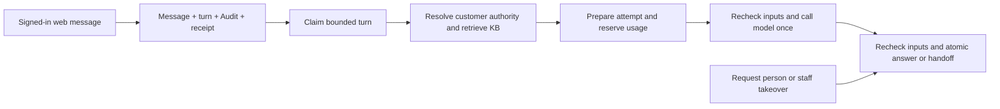

# Assistant coordination (SD-02)

## Release status and reading order

SD-02's source is merged in
[PR #38](https://github.com/pegma-dev/support-desk/pull/38) after review and
validation. This document records the coordination boundary; it claims no
deployment, live-provider, or pilot result. Follow
[the implementation ledger](KNOWLEDGE_AI_PLAN.md#status-and-reading-order),
[the durable layout checkpoint](COLLECTIONS.md#sd-02-assistant-turn-layout-checkpoint),
and the actual public types in `packages/application/src/assistant-turn-types.ts`
and `packages/ai/src/ports.ts` when changing this boundary.

The published `0.2.12` optional `@pegma/support-desk-ai` package owns coordination
and exact KB application/contracts `0.1.8` dependencies. The base application
remains usable without AI and contains no KB or model-provider dependency. The
current synchronized `0.2.12` release is published and strictly verified; see the
[publication receipt](RELEASING.md#verified-0212-publication-2026-11-14).
The released tuple retains those external KB pins and includes the
[wire-v2 checker correction](RELEASE_NOTES.md#0211-trusted-independent-check-policy).
Host activation retains its own acceptance gates. Existing registry versions
remain immutable.

### Released read scheduling (`0.2.1`)

The published `0.2.1` patch groups keyed observations for claim/preparation,
closed completion and queue projection. `finishAssistantTurnAttempt` retains
its turn-then-ticket sequence: an exact historical finish or terminal result
can return without starting a ticket read. Further finish batching is outside
this patch's scope.

Read waves are not a storage snapshot. Exact actor/input-bound completion
receipts retain precedence over fresh lease, feature and turn fences; current
service permissions are still required to recover an accepted result. Consumed
read failures retain their consumer order. Unused speculative failures are
settled without replacing an earlier unavailable-turn error or terminal claim
result.

Speculation can perform extra bounded work: completion may start a receipt read
before rejecting an unavailable ticket, and claim may start a ticket read before
returning an already-terminal turn. Unused observations grant no authority and
supply no returned private data. Not every path performs fewer Store reads;
complete supported host profiles require measurement. This release establishes
no universal Workers Free query or CPU allowance, host activation or live-provider
acceptance.

## One ticket transaction around external work

The ingress transaction stores the turn beside its causal customer message,
Ticket, Audit, receipt, and quota changes. Only an authorized signed-in web
message can create this work. Inspect the actual message channel: a ticket
created on the web retains `Ticket.channel: "web"` after an email reply, but
that email reply must follow the existing human handoff with reason
`email_reply`.

### Admitted intake (published 0.2.4)

Hosts can opt into
[`createAdmittedCustomerTicket`](../packages/application/README.md#admitted-customer-intake-next-candidate)
to recover the original human/assistant intake decision from the exact receipt
before repeating assistant qualification. A fresh write requires the trusted
late guard and, for an assistant decision, current same-principal
`assistantStart` authority. Retain the original packet on an unknown
acknowledgement. The returned initial mode is historical, while its customer
view reflects current handling. This operation keeps the existing handling,
turn, attempt and capacity defaults.

`AssistantTurnApplication` has five fixed operations:

| Operation                     | Purpose                                                                                                                                             |
| ----------------------------- | --------------------------------------------------------------------------------------------------------------------------------------------------- |
| `scanAssistantTurnCandidates` | Read one bounded physical scan page; persist and repeat the opaque continuation in the host.                                                        |
| `claimAssistantTurn`          | Recheck authoritative work, current service authority, ticket revision, handling generation, customer trigger, attempt budget, deadline, and lease. |
| `prepareAssistantTurnAttempt` | Persist exact immutable attempt/request identity and bounded generic bindings before the provider call.                                             |
| `completeAssistantTurn`       | Commit an answer or escalation under the claim and ticket fences with a read-only final validation guard.                                           |
| `finishAssistantTurnAttempt`  | Record bounded retry, superseded, or escalation disposition and conservative processing/accounting state.                                           |

The completion guard cannot add arbitrary transaction actions. Store conflict
callbacks re-read and re-decide; they never call the model. Lease, preparation,
and retry metadata updates do not bump Ticket revision. Automatic human
fallback is a domain transition and commits its handling change and work
atomically when configuration is disabled or attempts/deadline are exhausted.
Prepared attempt metadata is inline and bounded, including complete opaque KB
source bindings, rather than one growing row per attempt.

`createSupportDeskAssistant` exposes `scanCandidates` and `processTurn` over
those application operations. `processTurn` accepts
`ProcessAssistantTurnCommand`, the application's claim command without
`claimId`: callers supply ticket/turn, worker identity, and lease duration.
Each physical invocation generates a fresh internal cryptographic claim ID.
Duplicate external callbacks cannot share an unprepared live claim and charge
the provider under one reservation. The lower-level application claim API
retains same-worker/same-claim idempotency for the invocation's storage retries.
For a paid monolithic or staged-generation attempt, the coordinator calls
`AssistantModelPort.generate` at most once, outside storage retries. Staged
retrieval preparation reserves no usage and makes no model call. Retry of an
identical storage command is distinct from a new provider attempt. If an atomic
completion succeeds but the response is lost, exact command replay recovers
that result without adding another visible answer. A new invocation cannot
take, cancel, finish, or reconcile another invocation's unexpired claim; it
returns `not_claimed` until that lease expires. After expiry, a new claim
generation and bounded attempt retain earlier prepared/unknown metadata for
conservative usage reconciliation. A crash can therefore lead to a later new
provider attempt while earlier acceptance or usage remains unknown. The contract makes no
exactly-once provider-call or billing promise.
If an identical completion command still has an indeterminate storage result,
`processTurn` returns `pending` at `complete`; it neither finishes that attempt
nor regenerates in the same invocation. After lease expiry, a later claim
observes terminal work or starts a bounded new attempt while retaining the
prior prepared/unknown metadata.

### Opt-in durable staged retrieval

This protocol shipped in verified `0.2.2`, whose optional AI package pins KB
application/contracts to exact `0.1.5` with matching repository development/test
pins. The published `0.2.1` release keeps its immutable KB `0.1.2` graph. The
[0.2.2 receipt](RELEASING.md#verified-022-publication-2026-11-10) qualifies its
exact artifacts; each host separately verifies its installed graph and actual
composition. Published `0.2.3` retains this staged protocol, its result union,
attempt tradeoff and physical return.

`stagedRetrieval: true` on `createSupportDeskAssistant` splits a turn across
two separate physical host invocations. Omission retains the monolithic
coordinator. Both the application's `assistantTurns.maxAttempts` and the
verified configuration's `budgets.maxAttempts` must allow at least two
attempts. The existing counters are unchanged: the preparation owns attempt
one and claim generation one; the paid execution owns attempt two and claim
generation two. The protocol permits one paid opportunity, including when a
host allows more total attempts. It never resets counters, raises caps, or
repeats an ambiguous paid request.

The first invocation claims pristine work, resolves current configuration
and customer authority, retrieves complete approved sources, bounds the
model input and evaluates trusted escalation policy. It persists the existing
generic immutable preparation with version marker
`supportAnswerStage: "support-answer-retrieval-1"`. Its fingerprint binds the
complete logical conversation, ticket/handling/trigger tuple, model input,
configuration, authority, exact ordered source envelope and effective budgets.
Physical claim ownership, attempt number, lease, execution deadline and
reservation are excluded from this logical fingerprint. Only the hash,
versions, authority hash and complete source references are persisted; no
conversation or source body is copied into the preparation. Its predetermined
`retrieval:` identifier never reserves usage and never identifies a paid call.

The full validated configuration and customer-authority snapshots must match
across preparation and generation, not just their version labels. The binding
includes `dataControls.verifiedAt`, `dataControls.validUntil` and opaque
`usageScopeRef`. Re-attestation with new timestamps or a reissued usage scope
invalidates the prepared turn even when versions and logical settings stay the
same. This availability tradeoff is intentional: mismatch fails closed to
finish/handoff before a new reservation or model call. Resolvers still freshly
validate current inputs on every invocation and live guard; do not cache stale
evidence, strip timestamps or normalize away scope identity to force resume.

After the immutable preparation is acknowledged, the invocation calls the
existing exact `finishAssistantTurnAttempt` with `disposition: "retry"` and
`accounting: "not_called"`. Only an acknowledged `retry_scheduled` result
produces the public `prepared` outcome with ticket, turn, preparation-attempt
identity and next-attempt time. Failed or indeterminate finishes retain their
ordinary `pending` result; terminal or escalated finishes remain `finished`.
A one-attempt application cap can therefore safely escalate rather than
incorrectly reporting a resumable preparation. Cancellation prevents a
`prepared` outcome even if the no-call finish committed while its ACK was
pending.

The host must return after `prepared`. Retain the discovery checkpoint so the
same bounded scan can rediscover the retry promptly, then invoke the
coordinator from a genuine subsequent request, queue delivery or scheduler
invocation. Calling it again in the same invocation, including `waitUntil`,
does not provide a separate platform query allowance. A lost finish ACK can
leave the first call `pending` while the next invocation observes the durable
`not_called` retry and resumes safely. A preparation ACK alone is insufficient:
an unknown preparation without that durable no-call finish is never resumed.

The exported `AssistantProcessResult` union includes `prepared` for every typed
caller, even when `stagedRetrieval` is omitted or `false`. Exhaustive TypeScript
switches and matchers must add that case. Runtime production of `prepared`
requires opt-in staging; its handler returns and schedules a genuine later
invocation instead of continuing in the same invocation.

Only attempt two with exactly one tagged, durably `not_called` first-stage
preparation can generate. The new invocation claims freshly, resolves current
configuration/customer authority, and reconstructs the source envelope using
the exact references through `confirmAnswerSources`. It rebuilds the current
conversation input and requires the complete logical fingerprint, version
tuple, authority hash and preparation identity to agree. Expiry of the first
execution deadline grants no authority and does not prolong it: the resumed
execution receives its own fresh deadline, bounded by its new lease and the
unchanged turn deadline. Changed or unavailable input, arbitrary old
preparations, unknown preparations, and later claims fail closed to existing
bounded finish/handoff behavior. There is no lexical retrieval fallback in
that second stage.

The generation binding has marker
`supportAnswerStage: "support-answer-generation-1"` and binds the preparation
identity alongside the fresh physical request, reservation and deadline.
`AssistantAttemptContext.stagedRetrieval` distinguishes `preparation` and
`generation` for trusted server policy; `attempt` and `fence` retain their
actual durable values. Generation metadata never enters the model input.
The paid stage preserves the ordinary usage reservation/reconciliation,
identical live-preparation recheck, pre-call authority/source/configuration
guard, and every final-CAS guard. Its initial reconstruction confirmation is
additional to both existing confirmations. Unknown paid accounting remains
conservative; accepted completion receipts and post-commit queue projection
are unchanged. This protocol makes no universal query-budget claim: hosts
must measure complete real invocations, including conflicts, handoff,
projection and checkpoint work, on their actual adapters and platform.

## Separate service and customer authority

The worker's `serviceAccess` authorizes Support Desk worker operations. It is
never the customer's KB audience. `AssistantCustomerAuthorityPort.resolve`
independently resolves the current active ticket owner and current
permissions, permitted collections, applicability, policy/audience versions,
and usage scope. Inactive or unavailable authority fails closed.

Retrieval uses that customer authority through the actual KB
`retrieveAnswerSources` operation. After awaited retrieval, preparation, and
usage reservation, the coordinator repeats the identical prepare command to
recheck the live claim and deadline. Immediately before the paid provider call
it rechecks current customer/policy/applicability and calls
`confirmAnswerSources` for the entire supplied source set. Current bound
configuration/ZDR is the final awaited observation before generation. The
same complete input guard runs before every completion CAS, including sources
the model did not cite. Retirement, changed approval, audience changes, and
permission revocation must defeat stale results. These checks do not lease KB
state or create a cross-store transaction; each component keeps its own
authoritative contract. Invalidation before generation makes zero provider
calls, reconciles usage as `not_called`, and takes bounded human fallback or
supersedes stale work under the application fences.
Every awaited customer, source-confirmation, and configuration resolver in
this pre-generation guard uses the attempt deadline minus the commit reserve.
The final-CAS guard uses the full attempt deadline, preserving that separate
completion phase even when a resolver stalls before generation.

The model receives only trusted instructions, a bounded customer-visible
conversation, and explicitly delimited authorized source data. Internal notes,
private success/handoff evidence, source provenance, credentials, operational
context, and staff-only collections stay outside that input. Source and
customer text are untrusted data, never instructions that can broaden tools,
permissions, collections, or output destinations.

Current command permissions still protect exact historical completion replay;
an old receipt never restores revoked authority. Replay checks the same
accepted semantic command before fresh lease/feature fences, allowing an
unknown successful commit to be recovered after a lease or flag changes.

## Output and escalation

The complete raw JSON response is bounded in UTF-8 bytes before parsing. Its
structured result can only answer or escalate. Citations must exactly match
the supplied source references and use safe labels. A bot-answer source does
not imply a browsable portal article; the coordinator cannot invent URLs.
Before preparation, usage reservation, or a paid call, the coordinator reserves
the complete possible citation footer for every supplied approved source label
against `maxMessageCharacters`. This trusted option defaults to 20,000 UTF-16
code units and accepts 1–20,000; hosts must pass the actual application cap
when it is lower because the coordinator cannot inspect application settings.
The remaining answer allowance is `maxAnswerTextCharacters`. A remaining
allowance below 256 code units takes human fallback without a provider call.
Both effective limits appear in server-side `AssistantAttemptContext.budgets`
as `AssistantAttemptBudgets`, are bound into the request fingerprint, and the
answer-text allowance is appended to the trusted model instructions. The model
input still has its three declared fields. Validation enforces that allowance
and the final rendered body cap, including citations; it never truncates an
answer or procedural instructions to fit. A complete supported answer that
cannot fit must escalate.
There are no account actions, ticket resolution, arbitrary tools, autonomous
source execution, or automatic knowledge/issue publication.
Runtime schema and exact-citation validation do not establish factual support;
versioned grounding evaluations and host acceptance must still demonstrate
that answers follow the supplied sources and escalate unsupported conflicts.

Trusted `AssistantEscalationPolicy` can add host topic/security rules to the
shared fallback behavior. Missing sources, unsupported/conflicting guidance,
invalid output, disabled or unavailable controls, exceeded budgets, and
provider failures route to bounded human work according to that policy and
the application fences. The owned request-person command and staff takeover
remain usable without the model. The 12-row/one-human-message reserve preserves
their finite physical admission budget. Separately, preparing a turn requires
both a 52,000-byte current-row ceiling and a constructive check that every
maximum reachable completion, finish/retry/supersession receipt, and replacement
claim fits the 60,000-byte hard record cap. That check includes maximum legal
JSON-escaped processing metadata and all its stored copies, identifiers,
fences, and timestamps, while retaining earlier bindings/metadata unchanged.
Oversized preparation fails with the typed limit before a provider call and
leaves the claim available for bounded human handoff. Ordinary capacity limits
still apply; the [layout checkpoint](COLLECTIONS.md#sd-02-assistant-turn-layout-checkpoint)
records the complete encoded admission rule.

Disabling assistant handling preserves a new customer reply by atomically
moving it to human handling with bounded handoff work, rather than leaving an
unclaimable job. Staff reopening explicit assistant handling also writes
human handoff work in its lifecycle transaction. Deadline-expired work remains
discoverable even while a previous lease appears active; a retry scheduled at
or beyond the fixed turn deadline escalates instead.

## Host ports and data controls

| Port                             | Host responsibility                                                                                                                                  |
| -------------------------------- | ---------------------------------------------------------------------------------------------------------------------------------------------------- |
| `AssistantConfigurationPort`     | Resolve the current enabled version and verified data-control configuration for the actual provider route.                                           |
| `AssistantCustomerAuthorityPort` | Recheck current active principal, customer permissions, collections, policy/audience versions, applicability, and usage scope.                       |
| `AssistantModelPort`             | Execute the bounded selected provider request and return raw JSON plus processing/usage metadata. Honor abort/deadline and keep content out of logs. |
| `AssistantUsagePort`             | Durably reserve by the predetermined bound identity and reconcile idempotently; unknown usage stays conservatively reserved.                         |
| `AssistantTokenCounter`          | Count the complete prompt locally without network calls, logging, or persisted customer text.                                                        |
| `AssistantEscalationPolicy`      | Supply trusted topic/security escalation rules; customer text cannot configure policy.                                                               |

`AssistantDataControls` records the configuration binding, account, project,
endpoint, model, feature and exception references, intermediary references,
and verification/expiry times. An empty intermediary list explicitly means the
verified route has none. The trusted resolver must verify the actual
account/route/features and intermediary behavior against current documented
ZDR-compatible policy. A self-declared flag, a unit-test fixture, or a fake
provider cannot establish that operational evidence. Recheck the same bound
configuration after usage reservation immediately before the model call, then
again before every completion CAS.

Budgets bound messages, full input bytes/tokens, KB context tokens, raw output
bytes/tokens, time, cost/currency, attempts, and assistant turns. Local token
counting includes trusted instructions, conversation, serialized sources, and
the trusted selected adapter's wire-framing allowance. Durable host usage
reservation must succeed before a model call. Unknown provider usage or a
failed reconciliation remains reserved and visible for host repair.

The coordinator's invocation ceiling defaults to at most 25 seconds with a
one-second commit reserve. Configured generation duration caps at 20 seconds
and is further bounded by the actual turn deadline and lease. An independent
bounded wait rejects late output even when the adapter ignores cancellation.
A 30-second claim lease leaves time for final validation and atomic completion.
The application's
configured maximum lease defaults to 60 seconds and caps at 300 seconds;
that maximum is separate from each worker's requested lease. Identical storage
command retries default to two and cap at three; the coordinator performs no
local provider retry. Hosts must configure deadlines and leases consistently,
propagate cancellation, and prevent expired claims from committing. Keep the
generation kill switch independent of request-person and staff takeover.
The [optional package README](../packages/ai/README.md#limits-and-host-obligations)
records its enforced model/retrieval ceilings separately from the application
job caps in the collections reference.

## SDK validation and open host activation

Changes to this boundary require public-entry tests on memory and real Azurite,
using the actual KB with a fake provider. They must cover races, current
authority/source revocation including uncited sources, note exclusion, JSON
and citation attacks, budget/deadline exhaustion, ambiguous commits, usage
reconciliation, provider failures, email handoff, and disabled generation.
Duplicate external callbacks must leave another live claim untouched, and
configuration changes during an awaited usage reservation must prevent every
provider call. Answer-limit cases must cover the full citation footer and lower
application caps without truncation, and stalled pre-generation resolvers must
respect the tighter phase deadline. Each subsequent change requires its own
current-head gates.
Current-head Node 22/24 format/check/test gates and actual code/security review
remain required for changes; historical SD-01 or producer results do not
certify changed source. The completed `0.2.5` release gates are recorded in the
[publication receipt](RELEASING.md#verified-025-publication-2026-11-11).

Both hosts still need their own existing-login/current-Admin consent and
actual Codex, Claude Code, Grok Bot installed desktop/hosted-agent, and T3 Code
Codex-provider results. Grok Build CLI is not that Grok Bot target. Live staging
privacy/provider/intermediary evidence, full customer/staff/admin workflows,
retention and recovery operations, Task 12, acceptance, and pilots remain
open. retiregolden.org and pegma.dev compose separate stores, namespaces,
queues, policies, secrets, cursors, and retention; they are isolated instances,
not tenants. Keep private paths, actual customer data, secrets, and host
configuration outside the public repository.
